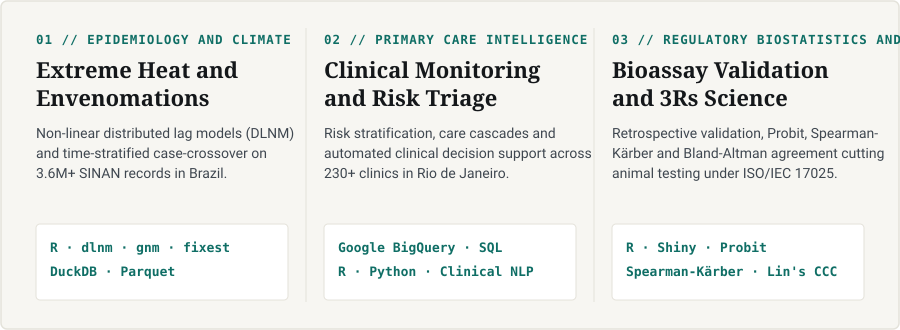

<a href="https://aapj.dev" target="_blank" rel="noopener noreferrer">
  <picture>
    <source media="(prefers-color-scheme: dark)" srcset="assets/header-dark.svg">
    <source media="(prefers-color-scheme: light)" srcset="assets/header-light.svg">
    
  </picture>
</a>

  
  
  
  
  
  
  

Health Data Scientist and Public Health Specialist at the Healthcare Intelligence Center (NIA / SMS-Rio), developing epidemiological indicators, longitudinal clinical care cascades, and scalable SQL/BigQuery pipelines for primary healthcare. PhD candidate in Public Health Epidemiology at ENSP / Fiocruz (OSF protocol `ykn6b`) modeling climate extremes and envenomations, with specialization in Health Informatics (UNIFESP) and prior experience in biological quality control and 3Rs alternative methods at INCQS / Fiocruz.

<picture>
  <source media="(prefers-color-scheme: dark)" srcset="assets/pillars-dark.svg">
  <source media="(prefers-color-scheme: light)" srcset="assets/pillars-light.svg">
  
</picture>

### Selected Work and Open Research

| Initiative / Focus Area | Domain and Scope | Key Stack | Reference and Code |
| :--- | :--- | :--- | :--- |
| **Primary Care Clinical Intelligence** | Longitudinal care cascades, clinical risk stratification, and surveillance across 230+ municipal health centers. | Google BigQuery SQL, Python, dbt, Evidence / Quarto | [Case Study on aapj.dev](https://aapj.dev/projetos/01-nia-inteligencia-assistencial) |
| **Heatwaves and Venomous Animal Accidents** | Non-linear distributed lag models (DLNM) and time-stratified case-crossover on 3.6M+ SINAN records across Brazilian biomes. | R (`dlnm`, `gnm`, `fixest`), DuckDB, Apache Parquet | [Case Study](https://aapj.dev/projetos/02-ondas-calor-peconhentos) · [`sus-duckdb-parquet-pipeline`](https://github.com/Aapereirajunior/sus-duckdb-parquet-pipeline) |
| **BioPotency and 3Rs Assay Validation** | Retrospective regulatory validation of 518 bioassays (Probit, Spearman-Kärber, Bland-Altman, Lin CCC) reducing animal distress by 50%. | R, Shiny, Bootstrapping, ISO/IEC 17025 | [Case Study](https://aapj.dev/projetos/03-biopotency-shiny-3rs) · [`biopotency-3rs-methods`](https://github.com/Aapereirajunior/biopotency-3rs-methods) |
| **Editorial Scientific Visuals and Portfolio** | High-density typography, accessible data visualization palettes, and reproducible publication figures. | Astro, Tailwind CSS, TypeScript, Sveltia CMS | [`aapj.dev`](https://aapj.dev) · [`aapj-editorial-r-theme`](https://github.com/Aapereirajunior/aapj-editorial-r-theme) |

### Selected Peer-Reviewed Publications

1. **Pereira-Júnior, A. A.**, Lima, F. H. D. M., Martins, I. F., Silva, R. S. F., Lucas, E. P. R. (2025). *Reducing time in lethality assay (LD50) for Bothrops jararaca and Crotalus durissus terrificus venoms and lethality neutralizing assay (ED50) for their respective antivenoms: A 3Rs-based retrospective data validation*. **Toxicon**, 262, 108358. [doi:10.1016/j.toxicon.2025.108358](https://doi.org/10.1016/j.toxicon.2025.108358)
2. Bacellar, D. T. L., Silva, C. S., **Pereira-Júnior, A. A.**, Moura, W. C., Villas-Bôas, M. H. S., Mattos-Guaraldi, A. L. (2026). *Diphtheria antitoxin potency assay: an in vitro alternative to the in vivo subcutaneous toxin neutralization test*. **Biologicals**, 93, 101870. [doi:10.1016/j.biologicals.2025.101870](https://doi.org/10.1016/j.biologicals.2025.101870)
3. **Pereira-Júnior, A. A.**, Silva, M. E. S., Carneiro, L. S., Aguiar, A. S., Souza, G. M., Dias, M. V. S., Bicalho, M. A. C. (2022). *Behavioral and neurochemical changes induced by nicotine exposure during lactation and/or stress in adult mice*. **International Journal of Developmental Neuroscience**, 82(8), 758–770. [doi:10.1002/jdn.10227](https://doi.org/10.1002/jdn.10227)
4. Martínez-Sobalvarro, C. E., **Pereira-Júnior, A. A.**, Silva, M. E. S., Oliveira, M. P., Dias, M. V. S., Bicalho, M. A. C. (2022). *Hospital antimicrobial stewardship programs in surgical antimicrobial prophylaxis: a systematic review*. **International Journal of Clinical Pharmacy**, 44, 301–319. [doi:10.1007/s11096-021-01358-4](https://doi.org/10.1007/s11096-021-01358-4)

[View all 7 peer-reviewed publications with open data on aapj.dev →](https://aapj.dev/#publicacoes)

### Technical Stack

| Layer | Tools and Environments |
| :--- | :--- |
| **Epidemiology and Statistics** | R (`dlnm`, `gnm`, `fixest`, `survival`, `ggplot2`, `gt`, `data.table`), Shiny, Biostatistics, Non-linear Time Series |
| **Data Engineering** | Google BigQuery SQL, DuckDB, Apache Parquet, Python (`pandas`, `polars`), dbt, ETL Pipelines |
| **Web and Publishing** | Astro, Tailwind CSS, TypeScript, Quarto, Markdown / MDX, Sveltia CMS, LaTeX |
| **Infrastructure** | Git, GitHub Actions, Docker, Linux, Cloudflare Pages |

---

  <a href="https://aapj.dev">aapj.dev</a> · <a href="mailto:aapereirajunior@gmail.com">aapereirajunior@gmail.com</a> · Rio de Janeiro, Brazil

